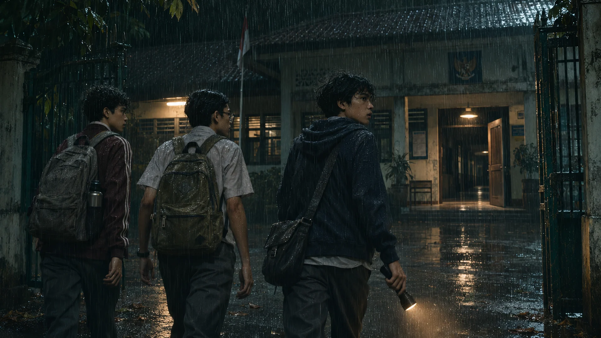

# Sekolah Setelah Tengah Malam

Bel pulang sudah berbunyi. Tapi tidak semua murid boleh pulang.

Game horor 3D orang pertama berbahasa Indonesia. Pukul 23.47, Raka kembali ke SMA Nusa Bangsa bersama Reski dan Akbar untuk mengambil map tugas. Ketika gerbang terkunci, petunjuk dalam absensi sekolah mengarah pada siswi yang hilang. Jelajahi sekolah dua lantai, pulihkan listrik, hindari Penjaga Bayangan, dan tentukan siapa yang pulang.



## Unduh

| Paket | Cara menggunakan |
| --- | --- |
| [Game Windows 64-bit](https://raw.githubusercontent.com/akhso10/godot/downloads/sekolah-setelah-tengah-malam-windows.zip) | Ekstrak seluruh ZIP. Jalankan **Sekolah.exe** dengan **Sekolah.pck** di folder yang sama. |
| [Proyek Godot lengkap](https://raw.githubusercontent.com/akhso10/godot/downloads/sekolah-setelah-tengah-malam-source.zip) | Di Godot 4.7.2, klik **Import**, pilih ZIP source, pilih folder tujuan baru yang kosong, lalu klik **Import**. Centang **Edit Now** untuk langsung membuka editor. Setelah impor selesai, tekan **F5**. Anda juga bisa mengekstrak ZIP melalui File Explorer lalu memilih **project.godot**. Untuk ZIP dari v1.0.0, gunakan cara File Explorer atau unduh ZIP source v1.0.1. |
| [Seluruh aset](https://raw.githubusercontent.com/akhso10/godot/downloads/sekolah-setelah-tengah-malam-assets.zip) | Berisi gambar, sumber GLB, tekstur, ikon, audio, font dan daftar aset. |
| [Checksum SHA-256](https://raw.githubusercontent.com/akhso10/godot/downloads/SHA256SUMS.txt) | Cocokkan dengan hasil `Get-FileHash namafile.zip -Algorithm SHA256` di PowerShell. |

Di GitHub, menu **Code → Download ZIP** pada branch **main** juga menyediakan source terbaru. Game hasil ekstraksi berjalan offline.

## Bermain

WASD untuk bergerak, mouse untuk melihat, E untuk berinteraksi, Shift untuk berlari, Ctrl untuk jongkok, dan Spasi untuk melompat. Tekan F untuk senter, R untuk baterai, Q untuk radio, Tab untuk tas, J untuk jurnal, M untuk denah, atau Esc untuk jeda. Tujuan aktif dan arah ruang muncul di kiri atas. Arahkan pandangan ke tanda interaksi sebelum menekan E.

Game menyimpan checkpoint di direktori pengguna Godot. Menu **Lanjutkan** memuat progres terakhir. Pengaturan menyediakan tingkat kesulitan, kendali efek suasana, volume dan skala render.

## Mengembangkan dan mengekspor

Dunia, pemain dan UI dirakit dari **scenes/main.tscn** lewat **scripts/**. Isi kampanye berada di **data/campaign.gd**. Folder **assets/** memuat bahan produksi, **tools/** berisi generator, dan **tests/** memuat uji regresi.

Pasang Godot **4.7.2 stable** dan export templates dengan versi yang sama melalui **Editor → Manage Export Templates**. Buka **Project → Export → Windows Desktop** dan pilih **Export Project**, atau jalankan dari akar checkout:

```sh
godot --headless --editor --import
mkdir -p build
godot --headless --export-release "Windows Desktop" build/Sekolah.exe
python tools/package_release.py dist
```

Untuk meregenerasi manifest gunakan Python 3.11+ dan Pillow. Pembuatan ZIP memakai Python 3.11+ serta Git. Langkah ini hanya untuk pengembang.

[Spesifikasi asli](docs/MASTER_PROMPT.md) · [Progres dan cakupan](DEVELOPMENT_PROGRESS.md) · [Hasil pengujian](TEST_REPORT.md) · [Manifest aset](ASSET_MANIFEST.csv) · [Sumber dan lisensi](docs/ASSET_LICENSES.md) · [Titik lanjut](NEXT_SESSION.md)
